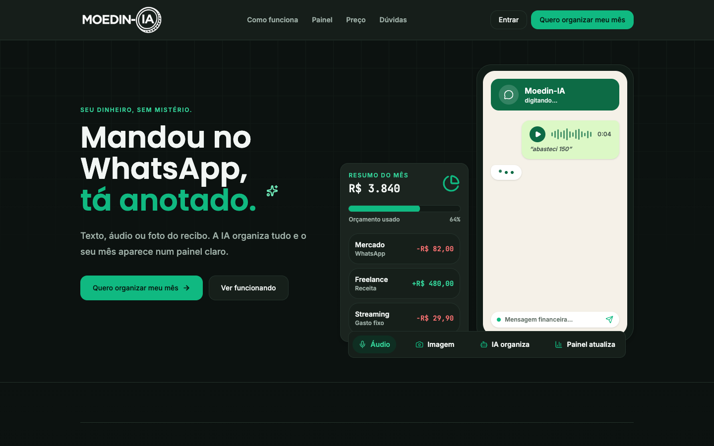
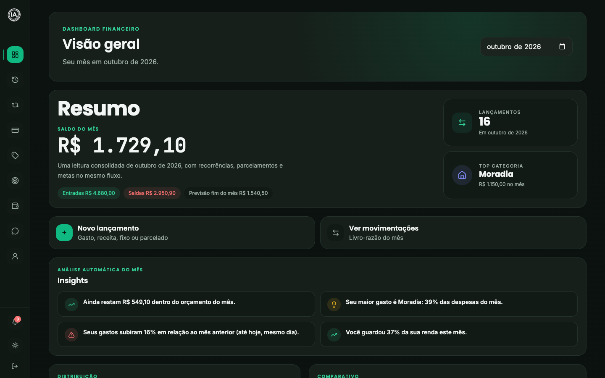
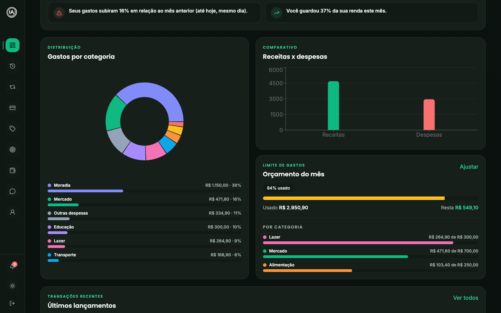
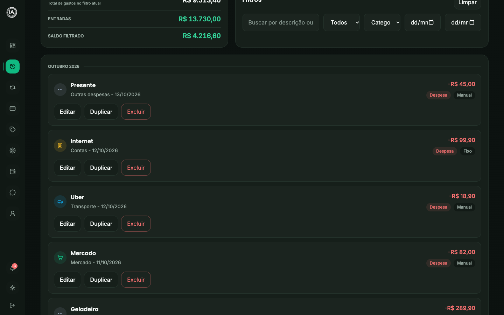
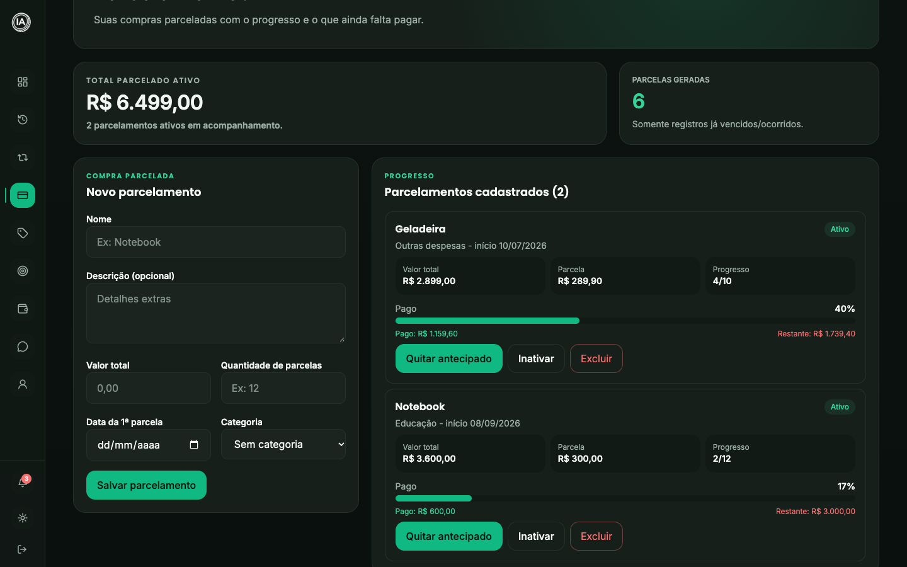
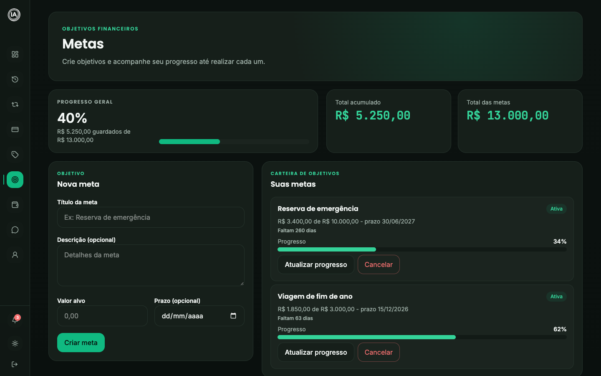
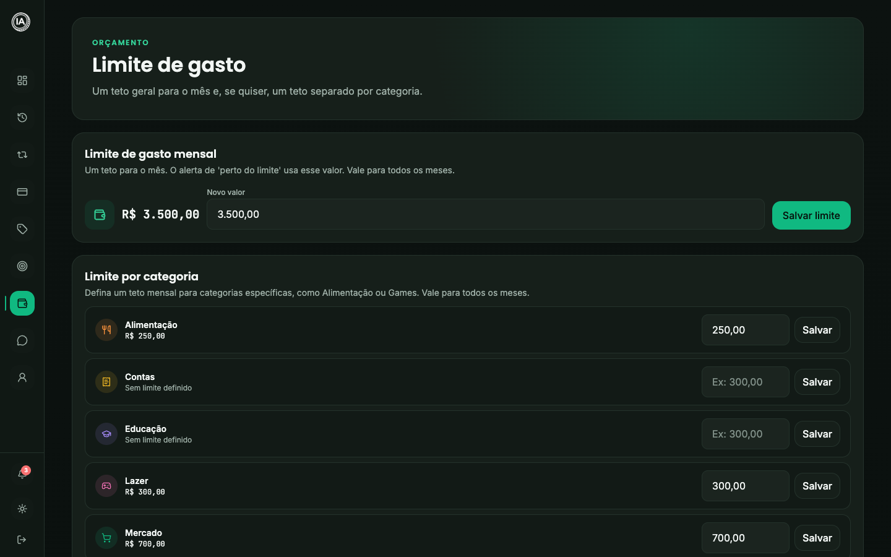
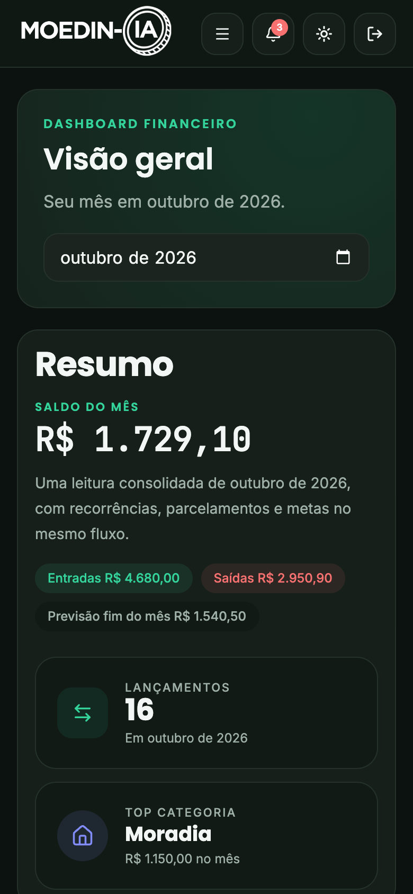

# Moedin-IA

Assistente financeiro pessoal. A pessoa registra gastos pelo **WhatsApp** (texto, áudio, foto de comprovante ou PDF de fatura) e acompanha tudo num **painel web**. Trabalho de Conclusão de Curso de Sistemas de Informação, em produção em <https://www.moedin-ia.com.br>.

O código atual fica na branch `main`. As versões anteriores estão em branches `versao-*` e em tags (ver [Versões](#versões)).



## Sumário

- [Telas](#telas)
- [Como o sistema é montado](#como-o-sistema-é-montado)
- [Estrutura do repositório](#estrutura-do-repositório)
- [Painel web (`apps/web`)](#painel-web-appsweb)
- [Bot do WhatsApp (`n8n/`)](#bot-do-whatsapp-n8n)
- [Banco de dados (`supabase/`)](#banco-de-dados-supabase)
- [Rodar localmente](#rodar-localmente)
- [Variáveis de ambiente](#variáveis-de-ambiente)
- [Testes e validação](#testes-e-validação)
- [Deploy](#deploy)
- [Segurança e LGPD](#segurança-e-lgpd)
- [Documentos relacionados](#documentos-relacionados)
- [Versões](#versões)
- [Equipe](#equipe)

## Telas

As capturas usam uma conta de demonstração com dados fictícios.

| Visão geral | Gráficos e orçamento |
|---|---|
|  |  |

| Histórico | Parcelamentos |
|---|---|
|  |  |

| Metas | Limite de gasto |
|---|---|
|  |  |

No celular:



## Como o sistema é montado

```text
 WhatsApp do usuário
        │
        ▼
 Evolution API ──webhook──▶ n8n (agente de IA) ──RPC──▶ Supabase (Postgres + Auth + Realtime)
 (servidor de casa)         (servidor de casa)                    ▲
                                  │                               │ leitura/escrita com RLS
                                  ▼                               │
                  Anthropic (Claude) + OpenAI    Painel Next.js (Vercel)
             (texto e visão)  (só transcrição)            ▲
                                                                  │
                                                         Navegador do usuário
```

Três peças, um banco só:

1. **Painel** (`apps/web`): Next.js 16 publicado na Vercel. Fala com o Supabase direto do navegador, protegido por Row Level Security.
2. **Bot** (`n8n/`): um workflow com o nó *AI Agent*. O modelo decide qual ferramenta chamar; cada ferramenta é uma função SQL (RPC) no Supabase. Roda num servidor doméstico, junto com a Evolution API (ponte com o WhatsApp) e o Redis.
3. **Banco** (`supabase/`): PostgreSQL gerenciado pelo Supabase. Guarda os dados, a autenticação e as regras de negócio do bot.

Quando o bot grava um lançamento, o painel aberto atualiza sozinho pelo Realtime do Supabase.

## Estrutura do repositório

```text
.
├── apps/
│   └── web/                 Painel e landing (Next.js). É o que a Vercel publica.
├── n8n/
│   ├── workflow/            Os três workflows que rodam em produção.
│   ├── AGENTE-V2.md         Documentação completa do bot, versão a versão.
│   ├── SYSTEM-PROMPT-AGENTE-V2.md   Prompt do agente (igual ao que está dentro do workflow).
│   └── lib/pdf-relatorio.js Fonte do gerador de PDF usado no workflow.
├── supabase/
│   └── migrations/          001 a 037: esquema, RLS, funções do bot, Realtime.
├── infra/bot/               Compose do servidor do bot, scripts de publicar, testar e backup.
├── docs/                    Explicação do código, auditoria de privacidade, revisão final.
├── historico/               Versões antigas guardadas para consulta. Nada ali roda.
├── docker-compose.yml       Ambiente local (n8n, Redis, Evolution, web).
└── .env.example             Modelo das variáveis de ambiente.
```

## Painel web (`apps/web`)

Next.js 16 (App Router), React 19, TypeScript, Tailwind CSS 4, Supabase SSR, Recharts, GSAP na landing.

### Rotas públicas

| Rota | O que é |
|---|---|
| `/` | Landing de venda (plano único) |
| `/login`, `/cadastro` | Entrada e criação de conta (e-mail e senha ou Google) |
| `/recuperar-senha`, `/atualizar-senha` | Redefinição de senha por link no e-mail |
| `/termos` | Termos de uso e política de privacidade |

### Rotas do painel (exigem login)

| Rota | O que faz |
|---|---|
| `/dashboard` | Resumo do mês, gráficos, previsão de fim de mês, análises automáticas e avisos |
| `/historico` | Todos os lançamentos, com filtros, edição, exclusão e exportação em CSV |
| `/fixos` | Gastos fixos e receitas fixas (recorrentes) |
| `/parcelamentos` | Compras parceladas, progresso e quitação antecipada |
| `/categorias` | Categorias com cor e ícone |
| `/metas` | Metas de economia |
| `/limite` | Limite de gasto do mês, geral e por categoria |
| `/whatsapp`, `/onboarding` | Vínculo do número com a conta, por código de ativação |
| `/perfil` | Dados pessoais, exportar dados, excluir conta |

`/gastos-fixos`, `/planejamento-mensal` e `/planos` existem só como redirecionamento de endereços antigos.

A proteção é feita em `src/proxy.ts` (no Next 16 o antigo *middleware* se chama *proxy*) e reforçada pelo RLS no banco.

### Rotas de API (`src/app/api`)

| Rota | Quem chama | O que faz |
|---|---|---|
| `POST /api/categories/ensure` | painel, ao entrar | Cria as categorias padrão que faltarem |
| `GET /api/account/export` | painel | Exporta todos os dados do usuário (LGPD) |
| `POST /api/account/delete` | painel | Exclui a conta e os dados (LGPD) |
| `GET /api/whatsapp/qr` | onboarding | QR code que abre a conversa com o bot |
| `GET /api/cron/recurrences` | Vercel Cron, 06:00 UTC | Gera os lançamentos de fixos e parcelas que venceram |

Todas exigem sessão, menos o cron, que exige `Authorization: Bearer $CRON_SECRET`.

### Regras de dinheiro e datas

- Valores são digitados no formato brasileiro e convertidos em `src/lib/formatters.ts`.
- Parcelas são divididas em centavos; a última fecha o total (`src/lib/money.ts`).
- Datas de negócio são sempre calculadas em `America/Sao_Paulo`, mesmo com o servidor em UTC (`src/lib/dates.ts`).
- Fixos e parcelas viram lançamento só quando vencem. Quem gera é `src/lib/recurrence-catchup.ts`, chamado ao abrir o painel e pelo cron diário. É idempotente: índices únicos no banco impedem duplicata.
- Excluir um lançamento é exclusão lógica (`status = 'deleted'`).

## Bot do WhatsApp (`n8n/`)

Workflow principal: `n8n/workflow/moedin-agente-v2.json` (105 nós, 27 ferramentas). Caminho de uma mensagem:

1. **Recepção.** O webhook confere um token secreto e ignora grupos e mensagens do próprio bot.
2. **Identificação.** O número é resolvido para um usuário pela tabela `whatsapp_links`. Quem não tem vínculo só consegue ativar com o código mostrado no painel.
3. **Mídia.** Foto e PDF são lidos pelo Claude Sonnet 5.5 (visão); áudio é transcrito pelo Whisper da OpenAI. O texto extraído chega ao agente marcado como dado, nunca como instrução.
4. **Agrupamento.** Mensagens enviadas em sequência são juntadas com um buffer no Redis.
5. **Agente.** Pedidos simples (ajuda, link do painel, relatório em PDF) são respondidos sem IA. O resto vai para o agente, que escolhe a ferramenta.
6. **Resposta.** Um nó de guarda apaga qualquer link que não seja do Moedin-IA antes do envio.

O identificador do usuário é sempre injetado pelo workflow; o modelo nunca escolhe de quem são os dados. Detalhes, decisões e histórico de versões estão em [`n8n/AGENTE-V2.md`](n8n/AGENTE-V2.md).

Outros dois workflows: `moedin-erros.json` (avisa o administrador quando o agente falha) e `moedin-alertas-diarios.json` (hoje só atualiza as cotações de câmbio; o bot não envia mensagens por iniciativa própria).

## Banco de dados (`supabase/`)

As migrations ficam em `supabase/migrations/`, numeradas de `001` a `037`, e são aplicadas em ordem pelo SQL Editor do Supabase.

| Faixa | Conteúdo |
|---|---|
| 001–004 | Tabelas base, RLS, criação automática de perfil, consentimento |
| 005–010 | Primeiras funções do WhatsApp, vínculo por código, Realtime em lançamentos |
| 011–021 | Receitas fixas, endurecimento de segurança, retenção de logs, índices únicos contra duplicata |
| 022–033 | Funções do agente: lançamentos, fixos, parcelas, metas, importação de fatura, câmbio, categorias, aviso de limite |
| 034 | Busca do bot sem acento e reconciliação do repositório com a produção |
| 035 | Correção de dados: categorias antigas sem dono |
| 036 | Bot: simular uma compra contra o limite e o saldo livre ("posso comprar 3000 em lazer?") |
| 037 | Bot: cotação de câmbio com mais de 3 dias não é usada |

Tabelas principais: `profiles`, `categories`, `transactions`, `fixed_expenses`, `fixed_incomes`, `installments`, `budgets`, `goals`, `user_settings`, `whatsapp_links`, `whatsapp_category_rules`, `message_logs`, `ai_insights`, `fx_rates`.

Todas têm RLS ligada: cada usuário só enxerga as próprias linhas. As funções `whatsapp_*` só podem ser executadas pela chave de serviço, usada pelo n8n.

## Rodar localmente

Pré-requisitos: Node.js 20 ou superior, um projeto Supabase com as migrations aplicadas e, para o bot, Docker.

### Painel

```bash
cd apps/web
npm install
cp ../../.env.example .env.local   # preencha as NEXT_PUBLIC_* e as chaves do servidor
npm run dev
```

Abre em <http://localhost:3000>. O script usa `next dev --webpack`.

### Bot, sem tocar no WhatsApp de verdade

```bash
docker compose -f docker-compose.yml -f infra/bot/docker-compose.teste-local.yml \
  up -d --no-deps redis evolution-stub n8n
bash infra/bot/testar-local.sh "gastei 30 no mercado"
```

A Evolution é substituída por um simulador e as respostas caem em `n8n/files/respostas.log`. O `--no-deps` é obrigatório: sem ele sobe a Evolution real. O banco usado é o de produção, então lançamentos de teste precisam ser apagados depois. Passo a passo em [`infra/bot/README.md`](infra/bot/README.md).

## Variáveis de ambiente

O modelo completo, com comentários, está em [`.env.example`](.env.example). As que o painel precisa:

| Variável | Onde | Para quê |
|---|---|---|
| `NEXT_PUBLIC_SUPABASE_URL`, `NEXT_PUBLIC_SUPABASE_PUBLISHABLE_DEFAULT_KEY` | navegador | Conexão com o Supabase (a proteção é o RLS) |
| `NEXT_PUBLIC_APP_URL` | navegador | URL canônica (sitemap, robots, Open Graph) |
| `NEXT_PUBLIC_WHATSAPP_NUMBER` | navegador | Número do bot no botão e no QR |
| `NEXT_PUBLIC_CONTACT_EMAIL` | navegador | Contato de privacidade nos termos |
| `SUPABASE_SERVICE_ROLE_KEY` | só servidor | Cron, exclusão de conta e contador da landing |
| `CRON_SECRET` | só servidor | Protege `/api/cron/recurrences` |
| `UPSTASH_REDIS_REST_URL`, `UPSTASH_REDIS_REST_TOKEN` | só servidor | Limite de requisições nas rotas de API |

Nunca use a chave de serviço com prefixo `NEXT_PUBLIC_`. Arquivos `.env*` não são versionados.

## Testes e validação

```bash
cd apps/web
npm run lint                # TypeScript + ESLint
npm test                    # Vitest: dinheiro, datas, recorrência e rotas protegidas
npx next build --webpack    # build de produção
```

Para o bot: `python3 infra/bot/testes-seguranca.py` roda 12 casos adversariais (pedidos fora de escopo, injeção de instrução por arquivo, tentativa de ver dados de outra pessoa) contra o ambiente local.

O relatório da revisão completa feita antes do fechamento está em [`docs/REVISAO-FINAL.md`](docs/REVISAO-FINAL.md).

## Deploy

- **Painel:** a Vercel publica a branch `main` do repositório de deploy. Configuração do projeto: Root Directory `apps/web`, Build Command `next build --webpack`.
- **Banco:** migrations aplicadas manualmente, em ordem, no SQL Editor do Supabase.
- **Bot:** `bash infra/bot/publicar-workflow.sh n8n/workflow/moedin-agente-v2.json` copia, importa e publica o workflow no servidor. No n8n, salvar não basta: o que roda é a versão publicada.

## Segurança e LGPD

- Row Level Security em todas as tabelas; funções do bot fechadas para o público.
- Cabeçalhos de segurança e Content-Security-Policy definidos em `apps/web/next.config.ts`.
- Webhook do bot protegido por token; limite de mensagens por número; resposta filtrada contra links externos.
- O usuário pode exportar e excluir os próprios dados pelo painel.
- O texto das conversas fica em `message_logs` por 180 dias e é apagado por um job diário no banco.
- Consentimento dos termos registrado por usuário e por versão.

Auditoria técnica de privacidade: [`docs/privacy-lgpd-audit.md`](docs/privacy-lgpd-audit.md).

## Documentos relacionados

| Documento | Conteúdo |
|---|---|
| [`docs/EXPLICACAO_DO_CODIGO.md`](docs/EXPLICACAO_DO_CODIGO.md) | Guia de leitura do código, arquivo por arquivo |
| [`n8n/AGENTE-V2.md`](n8n/AGENTE-V2.md) | Arquitetura e histórico do bot |
| [`infra/bot/README.md`](infra/bot/README.md) | Servidor do bot, publicação, backup e teste local |
| [`docs/REDIS-E-REGEX.md`](docs/REDIS-E-REGEX.md) | Onde o Redis e as expressões regulares aparecem |
| [`DESIGN.md`](DESIGN.md), [`PRODUCT.md`](PRODUCT.md) | Identidade visual e definição do produto |
| [`historico/LEIA.md`](historico/LEIA.md) | O que são os arquivos de versões antigas |

## Versões

Cada marco do projeto tem uma branch e uma tag com o mesmo código. Para ver uma versão: `git checkout versao-1.0`.

| Branch | Tag | Data | O que marca |
|---|---|---|---|
| `versao-0.1` | `v0.1` | 31/03/2026 | Protótipo inicial |
| `versao-0.2` | `v0.2` | 10/05/2026 | Sistema refeito em Next.js com Supabase |
| `versao-1.0` | `v1.0` | 10/06/2026 | Versão de junho |
| `versao-1.1` | `v1.1` | 18/08/2026 | Nova identidade visual, ajustes de interface e higiene do banco |
| `versao-2.0` | `v2.0` | 10/09/2026 | Agente de WhatsApp v2 no n8n e vínculo pelo painel |
| `versao-2.1` | `v2.1` | 30/09/2026 | Landing de plano único e agente v2.14 |
| `versao-3.0` | `v3.0` | 13/10/2026 | Revisão final: marca Moedin-IA, correções e limpeza do repositório |

A branch `meta-cloud-api` guarda a migração do bot para a API oficial da Meta, que está pausada.

## Equipe

Trabalho de Conclusão de Curso de Sistemas de Informação da FHO Uniararas.

- Alefe Cirino
- Gustavo Rodrigues
- Gustavo Timachi
- João Lima
- Márcio Junior

## Licença

Este repositório não tem licença definida.
