# Moedin-IA — resumo do projeto (portfólio)

> Assistente financeiro pessoal: você manda **"gastei 35 no mercado"** no WhatsApp (por texto, áudio, foto de comprovante ou PDF da fatura) e um agente de IA registra, categoriza e organiza tudo num **painel web** que atualiza em tempo real.

- **No ar:** <https://www.moedin-ia.com.br>
- **Tipo:** Trabalho de Conclusão de Curso — Sistemas de Informação, FHO Uniararas (2026)
- **Período:** março a novembro de 2026 · 92 commits · 7 versões marcadas (v0.1 → v3.0)
- **Equipe:** 5 pessoas (ver [Equipe](#equipe))

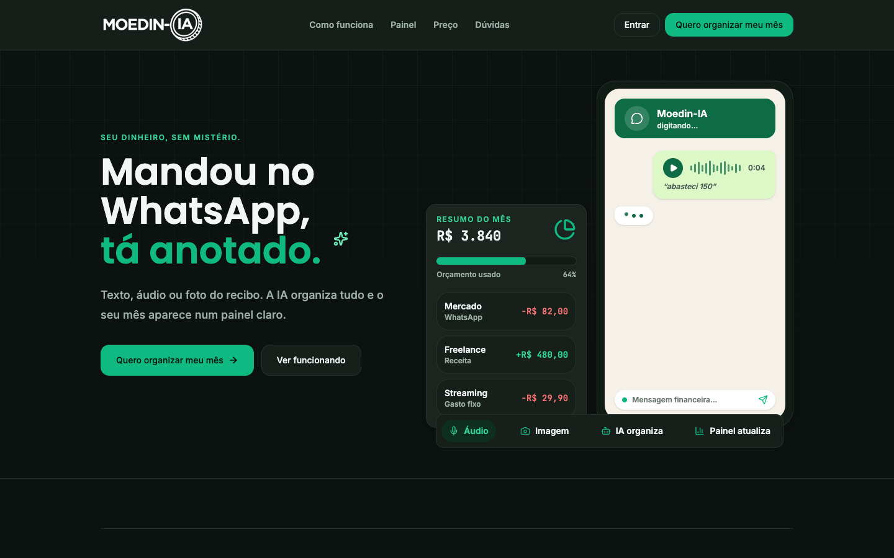

---

## Sumário

1. [O problema](#1-o-problema)
2. [A solução](#2-a-solução)
3. [Para quem](#3-para-quem)
4. [Funcionalidades](#4-funcionalidades)
5. [Prints](#5-prints)
6. [Arquitetura](#6-arquitetura)
7. [Tecnologias](#7-tecnologias)
8. [Desafios técnicos e como foram resolvidos](#8-desafios-técnicos-e-como-foram-resolvidos)
9. [Segurança e LGPD](#9-segurança-e-lgpd)
10. [Validação e resultados](#10-validação-e-resultados)
11. [Números do projeto](#11-números-do-projeto)
12. [Linha do tempo](#12-linha-do-tempo)
13. [Limitações e próximos passos](#13-limitações-e-próximos-passos)
14. [O que aprendi](#14-o-que-aprendi)
15. [Equipe](#equipe)

---

## 1. O problema

Controlar o próprio dinheiro depende de um hábito simples que quase ninguém mantém: **anotar cada gasto**.

- Apps e planilhas organizam bem os dados **depois** que eles existem, mas jogam no usuário o trabalho de abrir o app e preencher um formulário a cada compra. Esse atrito mata o hábito em poucas semanas.
- Num levantamento com 106 estudantes, **42% disseram não anotar as despesas**, e os autores ligam isso à falta de praticidade das ferramentas (Carvalho; Santos; Gregório, 2024).
- O contexto é sério: em maio de 2026, **81,6% das famílias brasileiras tinham alguma dívida**, o maior índice da série histórica da PEIC/CNC, iniciada em 2010.
- Os apps tradicionais (Mobills, Organizze etc.) têm interface densa, linguagem de banco ("economês") e tom que culpa o usuário.

**Em uma frase:** o problema não é falta de app de finanças, é que registrar dá trabalho demais — e sem registro não existe controle.

## 2. A solução

Tirar o formulário do caminho. A pessoa registra **onde ela já está o dia inteiro: o WhatsApp**.

| Em vez de... | No Moedin-IA |
|---|---|
| Abrir o app, escolher categoria, digitar valor, data, descrição | Mandar "uber 20 e almoço 35" |
| Digitar a fatura do cartão linha por linha | Encaminhar o PDF da fatura |
| Guardar o comprovante pra lançar depois | Mandar a foto do cupom |
| Planilha no fim do mês | Pedir "relatório" ou abrir o painel |

O diferencial é ser **híbrido de verdade**: o chat para registrar em segundos e o painel web para entender o mês num olhar. Os dois falam com o mesmo banco; o que entra pelo WhatsApp aparece no painel na hora.

## 3. Para quem

Brasileiros que querem controlar gastos sem planilha e sem "economês". Usam o celular no dia a dia e o computador na revisão do mês.

Na validação foram usados três perfis fictícios que representam o público:

- **Ana, 22** — primeiro emprego, manda mensagem curta e áudio, nunca anotou gasto.
- **Carlos, 38** — motorista de app, renda variável, precisa saber se "dá pra comprar".
- **Marta, 58** — aposentada, controlava tudo numa planilha do Excel.

Tom da marca: *"Seu dinheiro, sem mistério."* Amigo que entende de grana — nunca robótico, nunca julgador.

## 4. Funcionalidades

### Pelo WhatsApp (agente de IA com 27 ferramentas)

**Registrar**
- Gasto ou receita em linguagem natural, vários itens numa mensagem só ("uber 20 e almoço 35").
- **Áudio** — transcrito e registrado, entende "ontem", "sexta passada".
- **Foto de comprovante** — lê o cupom e registra valor, local e categoria.
- **PDF de fatura de cartão ou extrato** — lê todos os itens, separa compras parceladas, ignora o "pagamento recebido", pergunta "importo tudo, só os parcelados ou nada?" e **não duplica se a fatura for reenviada**.
- **Moeda estrangeira** — "paguei 40 dólares no hotel" vira real pela cotação do dia.
- **Categoria aprendida** — se você corrige uma categoria, ele lembra da próxima vez.

**Fixos e parcelas**
- "aluguel 1200 todo dia 10", "parcelei 1200 em 6x".
- Editar, pausar e reativar gastos fixos ("pausa a academia").

**Consultar**
- Relatório do mês por categoria, saldo, limite, "quanto gastei com uber esse ano", "setembro x agosto".
- **Relatório em PDF** gerado na hora e enviado na conversa.
- Link direto para o painel.

**Planejar**
- Limite de gasto do mês (geral e por categoria) com aviso quando passa.
- Metas de economia ("meta: juntar 3000 pra viagem").
- **Simular compra:** "posso comprar um fone de 400 em 4x?" → mostra o impacto no limite e no saldo livre, sem registrar nada.

**Corrigir**
- "o almoço foi 32 e não 35", "excluir o último", "desfazer importação". Se o termo bate em mais de um lançamento, ele pergunta em vez de chutar.

### Pelo painel web

| Tela | O que faz |
|---|---|
| **Dashboard** | Saldo do mês, entradas/saídas, previsão de fim de mês, gráficos por categoria e comparativo mensal, análises automáticas ("seus gastos subiram 16%") |
| **Histórico** | Todos os lançamentos com filtros, edição, exclusão e exportação CSV |
| **Fixos** | Gastos e receitas recorrentes, ativar/pausar |
| **Parcelamentos** | Compras parceladas com progresso e quitação antecipada |
| **Categorias** | Cor e ícone personalizados |
| **Metas** | Metas de economia com progresso |
| **Limite** | Teto do mês, geral e por categoria |
| **WhatsApp / Onboarding** | Vincula o número com código de ativação, botão e QR code que abrem a conversa |
| **Perfil** | Dados pessoais, exportar todos os dados, excluir conta (LGPD) |
| **Landing** | Página de venda com plano único e contador real de usuários |

Login por e-mail/senha ou Google, recuperação de senha, tema escuro esverdeado, responsivo no celular.

## 5. Prints

> Todas as capturas usam contas de demonstração com dados fictícios.

### WhatsApp — registrar

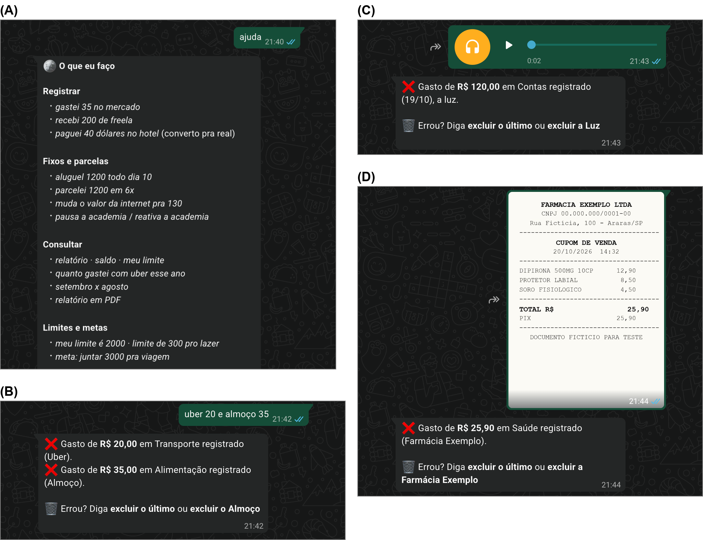

(A) o que o bot sabe fazer · (B) dois gastos numa mensagem · (C) áudio · (D) foto de cupom fiscal

### WhatsApp — corrigir, importar fatura, simular e relatório

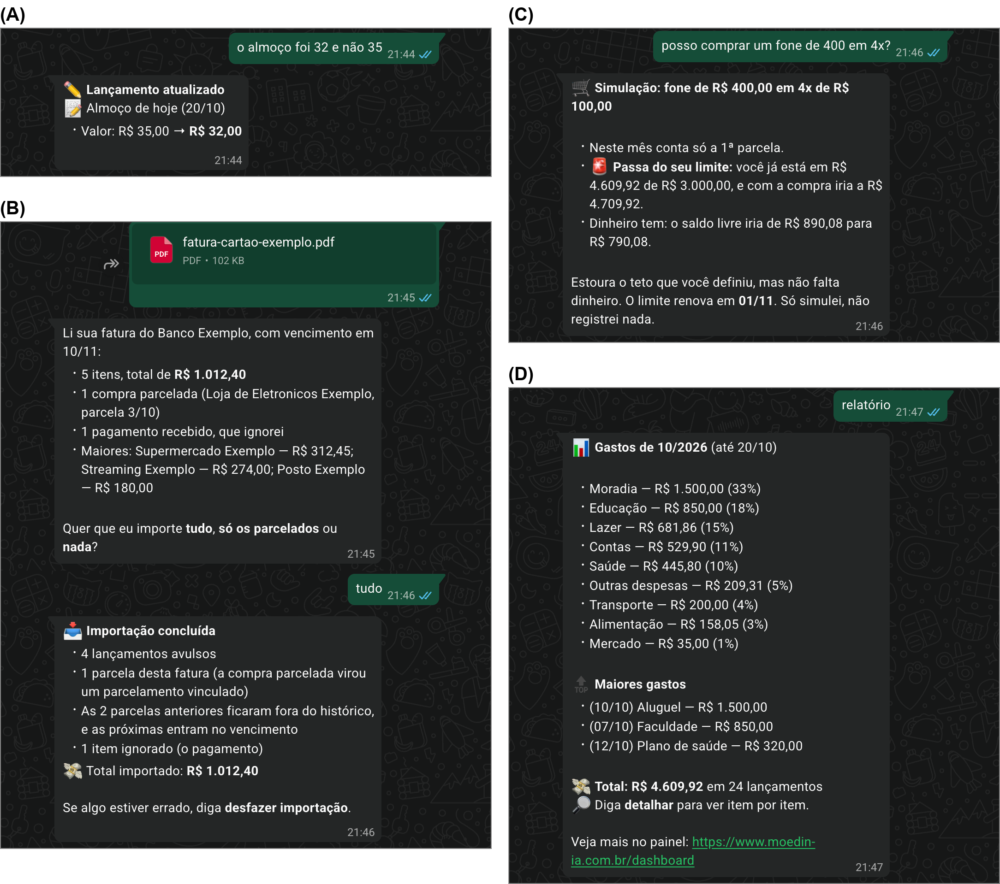

(A) corrigir valor · (B) importar fatura em PDF · (C) simular compra contra o limite · (D) relatório do mês

### Painel

| Visão geral | Gráficos e orçamento |
|---|---|
| 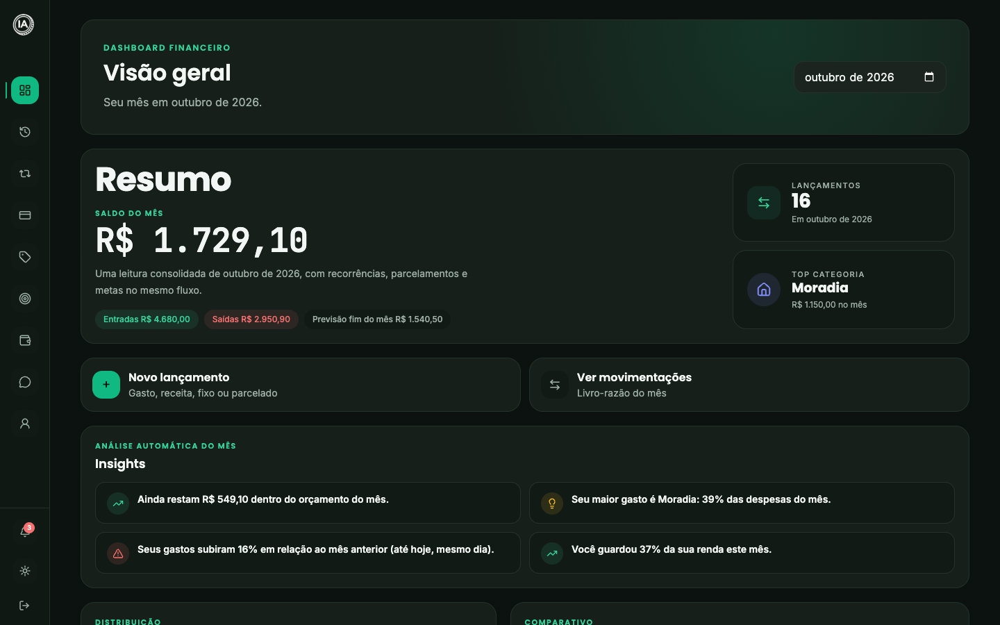 | 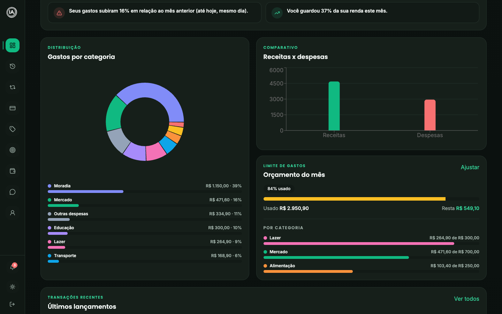 |

| Histórico | Parcelamentos |
|---|---|
| 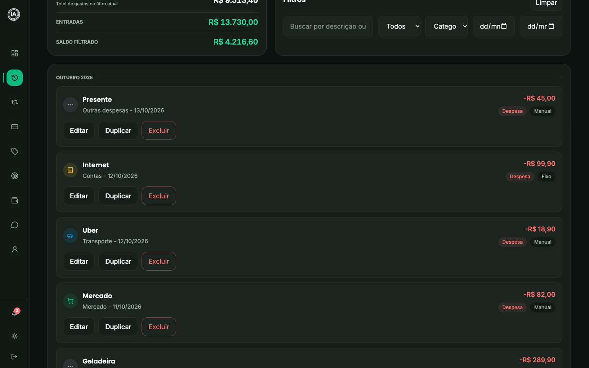 | 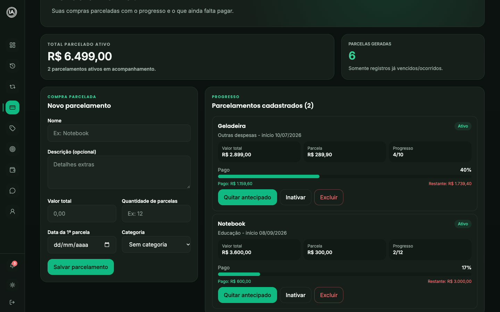 |

| Metas | Limite de gasto |
|---|---|
| 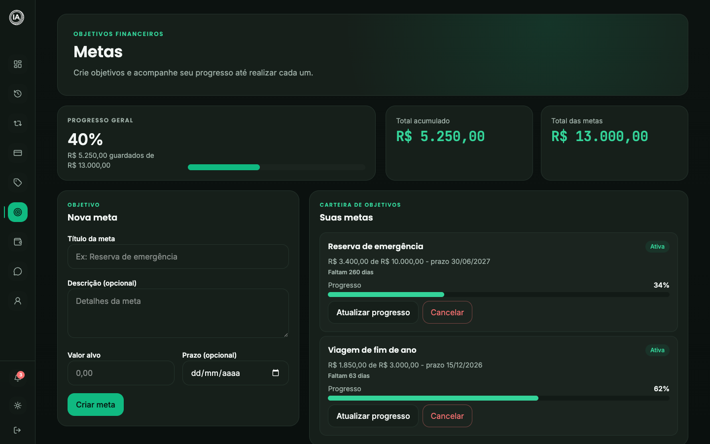 | 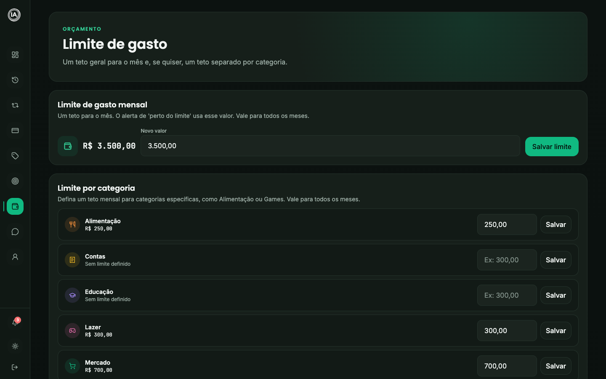 |

No celular:

## 6. Arquitetura

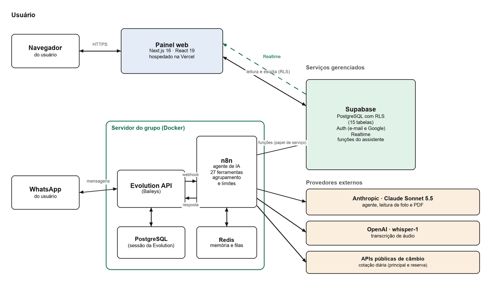

Três peças, **um banco só**:

1. **Painel** — Next.js 16 na Vercel (região São Paulo). Fala com o Supabase direto do navegador, protegido por Row Level Security.
2. **Bot** — workflow no **n8n** com o nó *AI Agent* (109 nós). O modelo decide qual ferramenta usar; **cada ferramenta é uma função SQL (RPC)** no Supabase. Roda num **servidor doméstico** (home lab, Docker) com a Evolution API (ponte com o WhatsApp) e o Redis.
3. **Banco** — PostgreSQL gerenciado pelo Supabase: dados, autenticação, Realtime e as regras de negócio do bot.

**Caminho de uma mensagem:**

1. **Recepção** — webhook confere um token secreto, ignora grupos e mensagens do próprio bot.
2. **Identificação** — o número vira um usuário pela tabela `whatsapp_links` (vínculo feito por código no painel).
3. **Mídia** — foto e PDF lidos pelo Claude Sonnet 5.5 (visão); áudio transcrito pelo Whisper.
4. **Agrupamento** — mensagens mandadas em sequência são juntadas por um buffer no Redis.
5. **Rota rápida** — "oi", "ajuda", "link do painel" e "relatório em PDF" são respondidos **sem chamar IA** (custo zero).
6. **Agente** — o resto vai para o modelo, que escolhe entre 27 ferramentas.
7. **Guarda de saída** — um nó apaga qualquer link que não seja do Moedin-IA antes de enviar.

Quando o bot grava, o painel aberto atualiza sozinho pelo **Supabase Realtime**.

### Modelo de dados

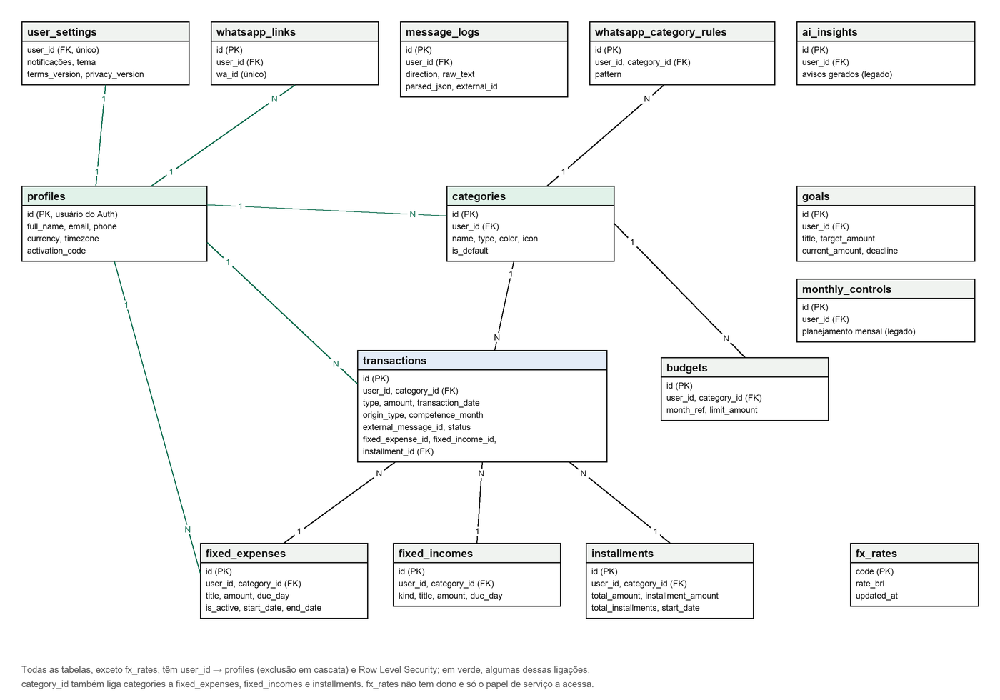

15 tabelas, todas com `user_id` e RLS. Destaques: `transactions` com exclusão lógica e origem (manual, fixo, parcela, receita fixa), `whatsapp_category_rules` (categoria aprendida), `fx_rates` (câmbio, só o servidor acessa).

### Casos de uso

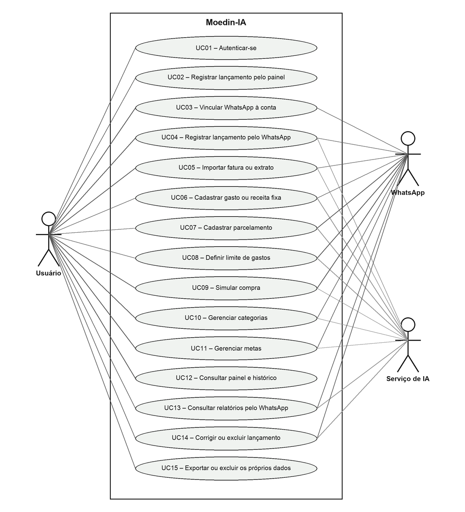

## 7. Tecnologias

| Camada | Tecnologias |
|---|---|
| **Front-end** | Next.js 16 (App Router), React 19, TypeScript, Tailwind CSS 4, Recharts, GSAP (landing), lucide-react |
| **Back-end / dados** | Supabase: PostgreSQL, Auth (e-mail + Google OAuth), Realtime, Row Level Security, funções PL/pgSQL, pg_cron |
| **Automação / IA** | n8n (AI Agent + 27 tools via HTTP/RPC), Anthropic Claude Sonnet 5.5 (agente, visão de foto e PDF), OpenAI Whisper (áudio) |
| **WhatsApp** | Evolution API (Baileys), Redis (buffer, memória da conversa, anti-spam) |
| **Infra** | Vercel (painel, Cron diário, região `gru1`), Docker Compose, servidor doméstico Linux, backup diário, domínio próprio `.com.br` |
| **APIs externas** | open.er-api.com e AwesomeAPI (câmbio, principal + reserva) |
| **Qualidade** | Vitest, ESLint, `tsc --noEmit`, bateria de 12 testes adversariais em Python, Mozilla Observatory, `npm audit` |
| **Segurança** | CSP, HSTS preload, rate limit com Upstash Redis, token no webhook |
| **Gestão** | Git/GitHub (branches e tags por versão), Kanban, modelo incremental |

## 8. Desafios técnicos e como foram resolvidos

**IA que não pode inventar dinheiro.**
O modelo só *escolhe* a ferramenta e extrai os campos; a validação e a gravação são feitas por **funções SQL determinísticas**. Conversão de moeda, divisão de parcelas em centavos e datas no fuso de São Paulo nunca passam pelo modelo. O `user_id` é sempre injetado pelo workflow — o modelo não tem como escolher de quem são os dados.

**Injeção de prompt por arquivo.**
O ataque real não é o usuário digitar "ignore as regras", é uma **fatura falsa encaminhada** com instruções escondidas. Defesa em camadas: o texto lido de PDF/foto/áudio entra marcado com uma etiqueta sorteada a cada execução (o arquivo não consegue forjar o fechamento), campos truncados, ferramentas destrutivas recusadas quando a origem não é texto digitado, e a **guarda de saída** que apaga links externos — a única camada que não depende do modelo. 12 de 12 casos adversariais passaram.

**Idempotência.**
Mensagem reenviada, fatura importada duas vezes, cron rodando de novo: índices únicos no banco (`external_message_id`, origem + competência) garantem que nada duplica. O "catch-up" de fixos e parcelas pode rodar quantas vezes quiser.

**Fatura com compra parcelada.**
"Parcela 3/10" na fatura vira um parcelamento vinculado: lança só a parcela daquela fatura e cria as restantes no vencimento, sem bagunçar os meses passados. A fatura do mês seguinte reconhece o marcador e lança só a parcela nova.

**Custo de IA.**
Rota rápida sem modelo para pedidos simples, prompt reordenado para aproveitar o cache de prefixo do provedor, memória curta de conversa e buffer que junta mensagens picadas numa chamada só.

**PDF sem biblioteca.**
O sandbox do n8n não permite instalar pacotes, então o relatório em PDF é **escrito à mão** (PDF 1.4, Helvetica, mapa de caracteres WinAnsi para acentos).

**Hospedagem barata e sem porta aberta.**
O bot roda num servidor doméstico em Docker, **sem nenhuma porta pública**: só faz conexões de saída; o editor do n8n é acessado por túnel SSH. Backup diário testado com restauração.

**Banco de produção divergente das migrations.**
Uma coluna que existia nas migrations nunca foi criada em produção e um `?? []` escondia o erro — os avisos de orçamento estavam mortos. Corrigido e criada uma migration de reconciliação; lição: nunca engolir erro de consulta em silêncio.

**WhatsApp não oficial.**
A Evolution API usa o protocolo do WhatsApp Web, que pode ser banido. Mitigação: "digitando" proporcional ao tamanho da resposta, nenhuma mensagem proativa, aviso único por dia para números estranhos. A migração para a API oficial da Meta está pronta numa branch separada.

## 9. Segurança e LGPD

- **Row Level Security em todas as tabelas** — cada usuário só enxerga as próprias linhas; funções do bot só executam com a chave de serviço.
- Vínculo do WhatsApp **só por código de ativação** (uma falha encontrada: o telefone do cadastro, não verificado, era aceito como identidade — corrigido).
- Content-Security-Policy, HSTS com preload, cabeçalhos de segurança, rate limit nas rotas de API.
- Webhook com token, limite de mensagens por número, mídia acima de 15 MB recusada.
- Exportar e excluir todos os dados pelo painel; conversas apagadas automaticamente após 180 dias; consentimento registrado por versão dos termos; política de privacidade publicada.
- Resultados: **nota B+ no Mozilla Observatory**, **0 vulnerabilidades conhecidas** nas dependências de produção, **12/12** casos adversariais aprovados.

## 10. Validação e resultados

- **15 de 15 casos de uso** validados com os três perfis fictícios (Ana, Carlos e Marta), cada um com **12 meses de dados** simulados (nov/2025 a out/2026, ~900 lançamentos).
- 25 passos de roteiro executados pelo WhatsApp e pelo painel, com evidência por print e consulta ao banco.
- **2 falhas reais encontradas e corrigidas** durante a validação (travamento após raciocínio estendido do modelo e reenvio de planilha duplicando) — viraram a versão 2.20 do bot.
- Testes automatizados (Vitest) para dinheiro, datas, recorrência e rotas protegidas.

## 11. Números do projeto

| | |
|---|---|
| Commits | 92 |
| Versões marcadas | 7 do sistema (v0.1 a v3.0); o bot chegou à v2.20 |
| Migrations SQL | 38 |
| Tabelas | 15, todas com RLS |
| Workflow do bot | 109 nós, 27 ferramentas |
| Código do painel | ~13 mil linhas de TypeScript/TSX |
| Telas do painel | 10 rotas logadas + landing, login, cadastro, termos |
| Entradas aceitas | texto, áudio, foto, PDF, planilha em PDF |

## 12. Linha do tempo

| Versão | Data | Marco |
|---|---|---|
| v0.1 | 31/03/2026 | Protótipo inicial |
| v0.2 | 10/05/2026 | Sistema refeito em Next.js + Supabase |
| v1.0 | 10/06/2026 | Versão de junho |
| v1.1 | 18/08/2026 | Nova identidade visual, ajustes de interface e higiene do banco |
| — | 06/09/2026 | **Site no ar** na Vercel |
| v2.0 | 10/09/2026 | Agente de IA no n8n + vínculo do WhatsApp pelo painel |
| — | 20/09/2026 | Domínio próprio `moedin-ia.com.br` |
| v2.1 | 30/09/2026 | Landing de venda com plano único |
| v3.0 | 13/10/2026 | Revisão final, marca Moedin-IA, limpeza do repositório |
| bot v2.16 | 20/10/2026 | Agente migrado para Claude Sonnet 5.5 |
| bot v2.20 | 05/11/2026 | Correções vindas da validação por perfis |

## 13. Limitações e próximos passos

- **WhatsApp não oficial** (Evolution/Baileys) — risco de banimento do número. Próximo passo: API oficial da Meta (branch `meta-cloud-api` pronta).
- **Dependência de provedores de IA** externos (custo e disponibilidade).
- **Sem avaliação com usuários reais** ainda — a validação usou perfis fictícios; a medição de precisão da extração está definida em protocolo.
- CSP ainda usa `unsafe-inline`; migrar para nonce.
- Integração com Open Finance para importar extrato direto do banco.

## 14. O que aprendi

- Usar LLM como **roteador de intenções** e deixar o banco como fonte da verdade: o modelo erra menos quando só escolhe a ferramenta.
- Segurança de agente é sobre **quem escreveu o texto** que entra no contexto, não só sobre o usuário.
- Idempotência por índice único resolve mais bug do que lógica no código.
- Colocar um produto de verdade no ar: domínio, DNS, OAuth verificado no Google, deploy, backup, monitoramento e custo.
- Documentar decisão junto com o porquê — o histórico de versões do bot (`n8n/AGENTE-V2.md`) virou a memória do projeto.

## Equipe

TCC de Sistemas de Informação da FHO Uniararas.

- Alefe Cirino
- Gustavo Rodrigues
- Gustavo Timachi
- João Lima
- Márcio Junior

---

**Mais detalhes:** [README técnico](../../README.md) · [Documentação do bot](../../n8n/AGENTE-V2.md) · [Explicação do código](../EXPLICACAO_DO_CODIGO.md) · [Auditoria de privacidade](../privacy-lgpd-audit.md)
